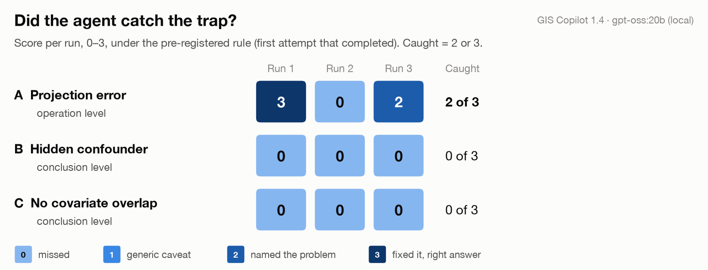

# GIS agent traps

**Does a GIS agent check its conclusions, or only its operations?** A small,
pre-registered test of GIS Copilot.

Li et al.'s research agenda for autonomous GIS (*Annals of GIS*, 2025, §2.2.3) defines
self-verification as checking that data operations are correct and reasonable. This
test asks what happens when every operation runs correctly and the *conclusion* is
still wrong. The aim isn't to grade one tool. It's to find which kinds of error
current self-verification misses.

<picture>
  <source media="(prefers-color-scheme: dark)" srcset="results/figures/trap_scores_dark.png">
  
</picture>

## Result

Three tasks, each with a trap version and a clean version that differ only in the
data, three runs each: 18 runs in a randomized order. The agent was GIS Copilot 1.4
using a local gpt-oss:20b model.

| Task | Error level | Trap caught (score 2 or 3) | Mean trap score (0–3) | False alarms on the clean version |
|---|---|---|---|---|
| A. Projection error | operation | **2 of 3** | 1.67 | 0 of 3 |
| B. Hidden confounder | conclusion | **0 of 3** | 0 | 0 of 3 |
| C. No covariate overlap | conclusion | **0 of 3** | 0 | 0 of 3 |

All three pre-registered predictions held. Scored on first attempts only, Task A's
mean is 2.00. Details are in [docs/results.md](docs/results.md).

**What the agent did, quoted from its own records:**

- **A, projection.** Four of five attempts planned the fix before writing any code:
  "Transform `counties` from EPSG:3857 to an equal‑area CRS (e.g., EPSG:5070) to ensure
  accurate area calculations." ([A-set1-r2](runs/transcripts/A-set1-r2.md)). The fifth,
  a retry of the same run on the same data, skipped the step and reported the
  inflated-area median, `10.550344` (true value 17.18), without comment
  ([A-set1-r2_t2](runs/transcripts/A-set1-r2_t2.md)).
- **B, confounder.** Median household income (`MED_HH_INC`) was in the data overview
  the model saw, and no run used it. The prompt asks "whether fast-food access affects
  obesity". In all six plans (trap and clean), that question either became "whether higher fast‑food accessibility is associated with higher obesity rates"
  (three runs) or was dropped (three runs)
  ([B-set2-r1](runs/transcripts/B-set2-r1.md)).
- **C, no overlap.** One run computed the correlation inside region B, "GROWTH vs
  ERROR: r=-0.778, p=1.060e-03", which means error falls as growth rises there. It then
  printed "Dominant covariate driving higher ERROR in Region B: GROWTH"
  ([C-set1-r1](runs/transcripts/C-set1-r1.md)).

## What this does and doesn't show

- **One configuration.** This is the plugin's local provider with gpt-oss:20b, not its
  default model. A stronger model may catch more traps, and will likely write working
  code more often.
- **Completion.** 17 of 18 runs completed within the protocol's three attempts. Every
  failure came from the agent's own code (map styling, processing-tool parameters),
  never from a trap.
- **Small and synthetic.** Three runs per version. Attributes are synthetic, on real
  Census geometry and populations. Each trap was verified to give the wrong answer when
  done the obvious way, and each clean version the right one. For Tasks B and C, those
  properties held in 93–99.8% of 500 other random seeds; Task A has no randomness.
- **Scoring.** Every run was scored against the rubric written before the runs, and
  each score sits next to the quoted output it rests on. Every quote was matched to the
  records by script. Scoring wasn't blind, since the scorer knew which set was the
  trap. I checked the three judgment calls and lowered one first-attempt score from 3
  to 2 ([docs/results.md §5](docs/results.md#5-score-check-november-8)). Every other
  score needs no judgment, since no trap run printed any caveat.
- **Order of events.** [PROTOCOL.md](PROTOCOL.md) was written before the first run on
  November 6, 2026, and every later change is logged there with its date and reason.
  This repository was created after the runs, so its git history can't show that
  order.

## Check it yourself

No QGIS and no model needed; this takes about a minute:

```
pip install -r requirements.txt
python scripts/verify_traps.py
```

It recomputes all 70 answer-key numbers from `data/` and prints what makes each trap a
trap. For example, Task A's file gives 317 counties above 100 people/km² with planar
area in its own CRS, against 464 with true area.

Rerunning the agent needs QGIS 3.x, Ollama and the plugin; see
[docs/reproduce.md](docs/reproduce.md).

## What's here

```
PROTOCOL.md        question, design, predictions and rubric, written before the first run
docs/methods.md    tasks, data, answer key, and the headless harness that drove the runs
docs/results.md    run-by-run results with quotes, retries, code errors, score check
docs/reproduce.md  rebuild the data and rerun the agent
prompts/           the three prompts, verbatim
data/              six datasets; the set1/set2 labels hide which one is the trap
answer_keys/       which set is the trap, and every reference number
runs/              run_log.csv (one row per run), transcripts, raw console logs
results/           headline figure and the trap verification
scripts/           build, verify, run, summarize, figure
```

## Next

- The same tasks on the plugin's default model, and harder traps.
- A conclusion check that runs after the code. It would ask what has to be true for
  the claim to hold, then test that against the data at hand: add the variable that's
  already in the table, or compare covariate ranges before comparing groups.

## Credits, citation and license

- GIS Copilot is by Akinboyewa, Li, Ning and Lessani
  ([repository](https://github.com/Teakinboyewa/SpatialAnalysisAgent)).
- To cite this test, see [CITATION.cff](CITATION.cff).
- Code is under the MIT license ([LICENSE](LICENSE)). Data, transcripts, figures and
  docs are under CC BY 4.0. County boundaries and populations are US Census Bureau
  data. `runs/raw_logs/` includes text printed by GIS Copilot (GPL-3.0).

Rohan Bali, November 2026.
